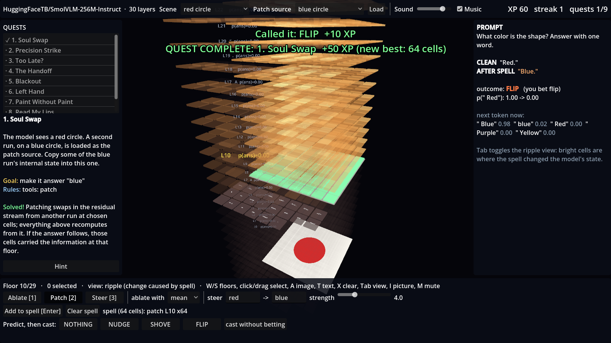

# Glassbox

A game for building intuition about what happens inside a vision-language model.
You climb a tower where each floor is one transformer block, cast "spells" that
rewrite the model's internal state, **bet on what will happen first**, and see what
the model actually does. Your prediction hit rate is the real score.



## How it fits together

```
Godot 4 client (godot/)  <-- WebSocket JSON -->  Python backend (backend/)
  tower, HUD, quests,                              model adapter -> hook engine
  XP / predictions                                 (PyTorch forward hooks)
```

- **Adapters** (`backend/glassbox/adapters/`) map an architecture onto a common schema:
  residual blocks, unembedding, tokens tagged image/text/special. A new model means
  one new adapter; the game doesn't change.
- **Engine** (`backend/glassbox/engine.py`): captures the residual stream after every
  block and applies the tools:
  - **ablate**: replace cells with the same-kind mean, or zero
  - **patch**: copy cells from another loaded scene (same prompt → same layout)
  - **steer**: add `scale * (r(to) - r(from))` at a floor
- **Outcomes** players bet on: `nothing` (<5 pt change in p(clean answer)),
  `nudge` (5–30), `shove` (>30, answer kept), `flip` (answer changes).

## Running it (Windows)

```powershell
# backend, once
cd backend
python -m venv .venv
.\.venv\Scripts\python.exe -m pip install torch --index-url https://download.pytorch.org/whl/cu130
.\.venv\Scripts\python.exe -m pip install -r requirements.txt
.\.venv\Scripts\python.exe scripts\make_scenes.py

# every session
.\run.ps1                      # SmolVLM-256M on GPU (~0.7 GiB VRAM)
.\run.ps1 -Model tiny          # random tiny model, for client development
```

Then open `godot/project.godot` in Godot 4.7 and press F5.

Checks:
- `.\.venv\Scripts\python.exe -m pytest tests` checks the engine with no download.
- `.\.venv\Scripts\python.exe scripts\smoke.py` checks the real model.
- `godot --path godot -- --autotest` plays quest 1 end to end and saves a screenshot.

## Controls

W/S climb floors · click/drag select cells (Shift adds) · A all image cells · T all text
cells · X clear · Enter add selection to spell · 1/2/3 tools · Tab activity/ripple view ·
I toggle picture · M mute · right-drag orbit · middle-drag pan · wheel zoom

## Sound

All audio is synthesised at startup in `godot/scripts/audio.gd`: no audio files. Two
sounds carry information:

- **Floor tone**: when you change floors, a glass note plays whose pitch is p(clean answer)
  at that floor, read by the logit lens (A minor pentatonic, low = unsure, high = sure).
  Climbing the tower, you hear the answer form.
- **Ripple sweep**: after a cast, one ping per floor rising up the tower, louder where
  the spell changed the model's state more.

The rest is feedback: select/add/cast sounds, an outcome sting (nothing/nudge/shove/flip),
a verdict on your bet, a quest fanfare, and a looping ambient drone that rises as you
climb. Volume, Music and M (mute) are saved with your progress. To audition or tweak
the sounds outside the game:
`godot --headless --path godot -s res://tools/export_sounds.gd` writes them all as WAVs.

## Verified findings on SmolVLM-256M (the quests are built on these)

- Patching all 64 image cells from a blue-circle run flips "Red"→"Blue" on floors 0–22,
  and fails from 23 up.
- Patching **only the last position** fails on floors 0–22 and works from 23 up.
  Floors 22→23 are where colour moves from image tokens to the answer position.
- Mean-ablating every image cell never removes "Red", because the mean is still reddish.
  Zero ablation does remove it, but pushes the model off-distribution.
- Steering ` red`→` blue` on image cells at floor 10, strength 4, gives "blue" but then
  repeats it ("blue blue blue…"). Steering only the last position mostly breaks the model.

## Roadmap toward big MoE models

1. ✅ Small VLM (SmolVLM-256M): patch board, tower, logit lens, 3 tools, quests
2. Attention lines view; per-head ablation
3. Small MoE (e.g. OLMoE-1B-7B, 4-bit or CPU offload on 6 GB): router view, expert
   rooms, router override tool
4. Feature cards from SAEs/transcoders, where published ones exist
5. Large models via a remote backend: the client already only talks over WebSocket, so
   pointing `backend.gd`'s `url` at a rented GPU box running the same server is the plan.
   Expect cached activations and narrow experiments rather than live play over the
   whole model.
